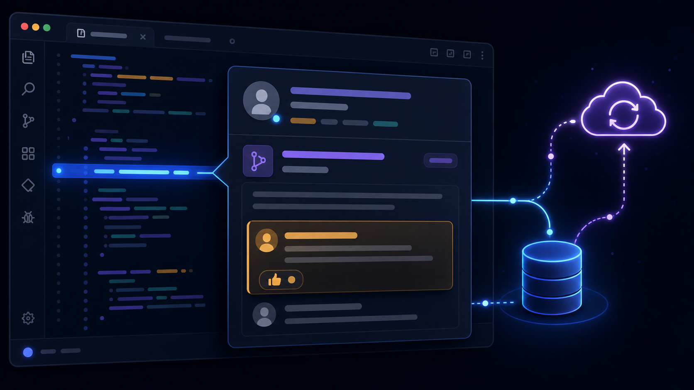
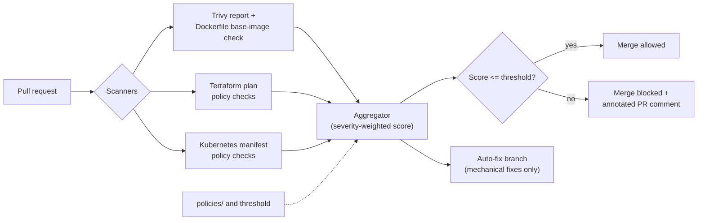

# pipeline-guard

A shift-left security gate for CI: it scans container images and infrastructure-as-code on every pull request, scores the findings against a threshold, and blocks the merge, with an auto-fix branch for the mechanical remediations.

[](https://github.com/PranitaG14/pipeline-guard/actions/workflows/ci.yml)



## Why

Vulnerable base images and misconfigured IaC (open security groups, public buckets, missing encryption, privileged containers) slip through review because "looks fine" is not a control. By the time they reach production they are incidents. pipeline-guard runs the check automatically before merge and fails with a readable, annotated PR comment and a fix, not a wall of raw scanner output.

## Features

- Normalizes Trivy image reports, a Dockerfile base-image check, Terraform plan JSON and Kubernetes manifests into one finding model.
- Built-in policy checks that mirror the Rego rules in `policies/`, so no `conftest` binary is required (a `ConftestRunner` wrapper is included for environments that have it).
- Severity-weighted risk score (CRITICAL 20, HIGH 10, MEDIUM 4, LOW 1) compared against a configurable threshold; exit code 1 when blocked.
- Markdown PR comment with a severity table and one row per finding, including rule ID and remediation hint.
- Auto-fix planner for mechanical fixes (outdated base image tag, missing `encrypted` / `storage_encrypted` flags) that can commit to a real branch.
- Packaged as a GitHub Action (`action.yml`) and as a `pipeline-guard` CLI.

## Architecture



Each scanner adapter emits `Finding` objects; the aggregator sums their weights and the gate compares the total to the threshold. Reporting and auto-fix both consume the same `ScanResult`, so adding a scanner touches one adapter and nothing downstream.

## Quick start

Prerequisites: Python 3.10+ (CI runs 3.10, 3.11 and 3.12). Everything runs offline against the bundled fixtures.

```bash
python -m venv .venv && source .venv/bin/activate
pip install -e ".[dev]"

# Run the tests
python -m pytest -q

# Gate the intentionally vulnerable fixtures (exits 1)
pipeline-guard scan \
  --dockerfile fixtures/docker/Dockerfile.vulnerable \
  --trivy-report fixtures/trivy/report-vulnerable.json \
  --terraform-plan fixtures/terraform/vulnerable/plan.json \
  --k8s fixtures/k8s/deployment-vulnerable.yaml
```

Or run the whole walkthrough (clean scan, blocked scan, auto-fix plan) with `bash demo/run_demo.sh`.

## Usage

Scanning the clean fixtures passes:

```text
## pipeline-guard security gate: PASSED
Risk score 0 (threshold 30) across 0 finding(s)
```

Scanning the vulnerable fixtures is blocked (trimmed):

```text
## pipeline-guard security gate: BLOCKED
Risk score 179 (threshold 30) across 21 finding(s)
| Severity | Count |
| CRITICAL | 5 |
| HIGH     | 4 |
| MEDIUM   | 9 |
| LOW      | 3 |
```

The full rendered comment is in [`demo/sample-blocked-pr-comment.md`](demo/sample-blocked-pr-comment.md). Seven of those 21 findings are mechanically fixable; feed the JSON report to `autofix`:

```bash
pipeline-guard scan ... --json-out scan.json
pipeline-guard autofix --scan-json scan.json --terraform-dir <dir-with-main.tf>
```

```text
Auto-fix plan: pipeline-guard: mechanical security fixes
  - [BASE-IMAGE-OUTDATED] Dockerfile: Bump python:3.9 -> python:3.12-slim
  - [TF-ENCRYPTION-MISSING] main.tf: Set encrypted = true on aws_ebs_volume.data
  - [TF-ENCRYPTION-MISSING] main.tf: Set storage_encrypted = true on aws_db_instance.primary
```

Add `--apply --repo-dir <repo>` to commit those patches to a `pipeline-guard/auto-fix` branch. Useful `scan` flags: `--threshold`, `--config`, `--report-out`, `--json-out`, `--no-fail` (report-only mode).

As a GitHub Action, use the repo's `action.yml` with inputs such as `dockerfile`, `trivy-report`, `terraform-plan`, `k8s-manifests` and `threshold`.

## How it works

- **Scanner adapters** (`src/pipeline_guard/scanners/`) turn Trivy output, Dockerfile base images, Terraform plans and Kubernetes manifests into shared `Finding` objects.
- **Policy as code** (`policies/`) holds the Rego rules; the same checks are reimplemented in Python so the gate works without installing Conftest. When a `.rego` rule changes, its Python counterpart must change too; tests pin both to the fixtures. See [policies/README.md](policies/README.md).
- **Aggregator** sums severity weights, so one CRITICAL outweighs several HIGHs: a single open security group should gate a build even if the rest of the report is quiet.
- **Auto-fix** only touches changes with no judgment call. Open security groups, public S3 ACLs, privileged containers and missing resource limits are left for a human.
- Walkthrough with real output: [demo/README.md](demo/README.md).

## Testing

```bash
python -m pytest -q --cov=pipeline_guard
```

65 tests cover the aggregator, each scanner, report rendering, the auto-fix patches, the GitHub client abstraction and the CLI end to end (including committing to a real local git repo). CI also runs the gate against the clean fixtures (must pass) and the vulnerable fixtures (must block).

## Project layout

```text
src/pipeline_guard/   CLI, aggregator, reporting, autofix, github_client
  scanners/           trivy, terraform_policy, k8s_policy, policy_engine
policies/             Rego rules (terraform, kubernetes)
fixtures/             clean and vulnerable Docker / Terraform / K8s / Trivy inputs
demo/                 end-to-end walkthrough and sample reports
tests/                pytest suite
action.yml            GitHub Action definition
```

## Limitations

- Trivy is consumed as a pre-generated JSON report; the tool does not invoke Trivy itself.
- The built-in rule set is deliberately small (security groups, S3, RDS/EBS/SQS encryption, pod security basics).
- Opening real pull requests uses a REST client that needs the optional `github` extra and a token; local runs use a local-git client.

## License

MIT, see [LICENSE](LICENSE).

## Maintainer

Originally published under the `PranitaG14` GitHub account, this project is currently maintained by **Pranita Ashok Ghebad**, a Senior Automation Developer with 8 years of experience delivering BPM and automation solutions.

For project inquiries: [paghebad@gmail.com](mailto:paghebad@gmail.com).